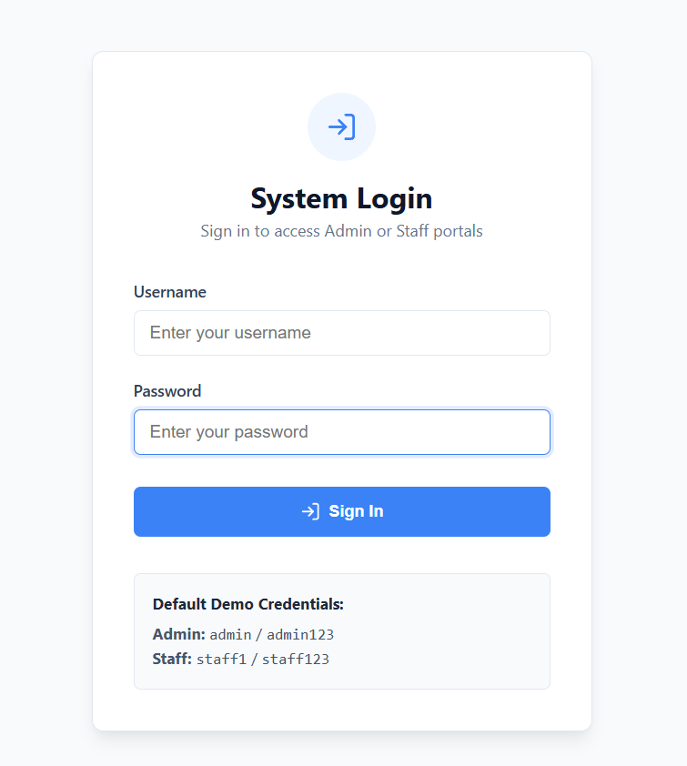
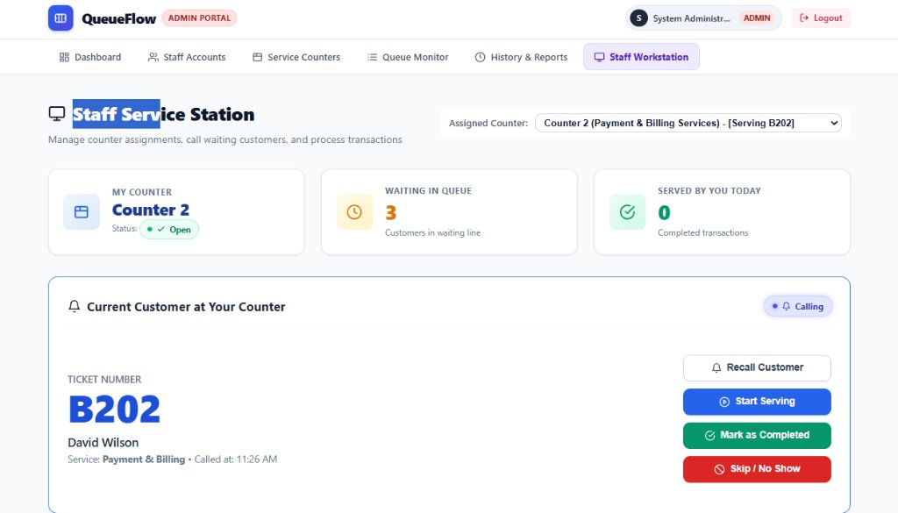
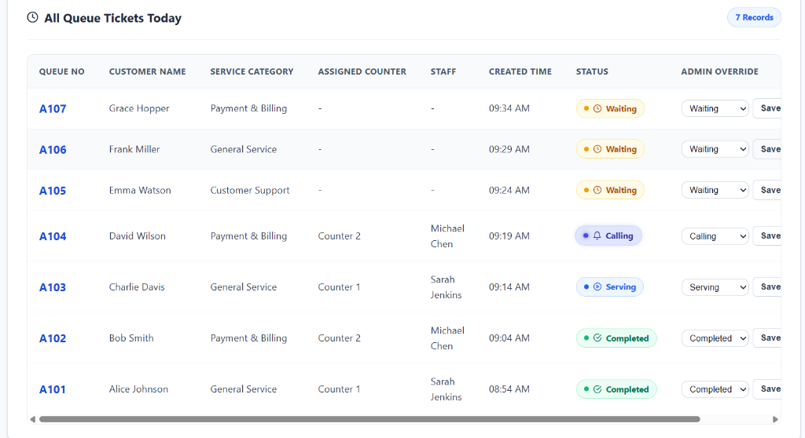
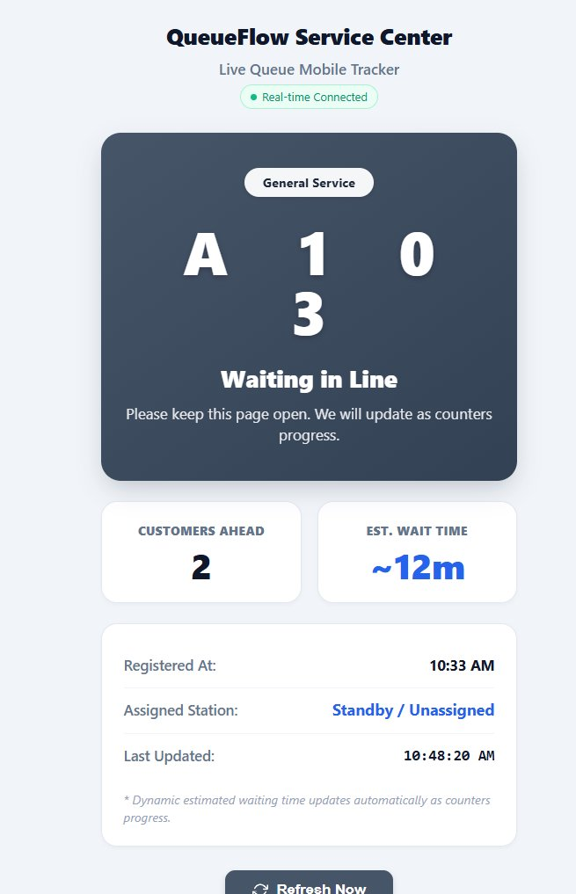
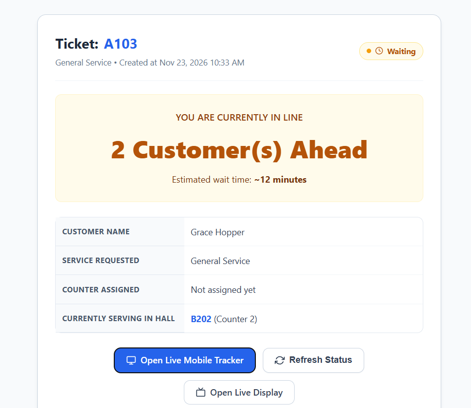

# Queue Management System (QueueFlow)

A modern, responsive, and robust Queue Management System built with **HTML5, CSS3, Native PHP, and MySQL**. Designed according to realistic service center queue operational workflows with strict counter-to-department routing, live calling display, QR-code mobile waiting tracker, and an administrative control suite. Ready for local deployment using **XAMPP** or cloud deployment via **cPanel**.

[](LICENSE)
[](https://www.php.net/)
[](https://www.mysql.com/)

---

## 1. System Screenshots & Preview

| Portal Login | Live Calling Display |
| :---: | :---: |
|  |  |

| Staff Service Workstation | Administrator Queue Monitor |
| :---: | :---: |
|  |  |

| Mobile Live Tracker | Ticket Status Search |
| :---: | :---: |
|  |  |

---

## 2. Key Features

- **Sequential Departmental Numbering**:
  - **Series A (A101+)**: General Enquiries & Registration (Counter 1)
  - **Series B (B201+)**: Payment & Billing Services (Counter 2)
  - **Series C (C301+)**: Customer Support & Documentation (Counter 3)
  - **Series P (P401+)**: Priority & Express Services (Counter 4)
- **Strict Service Counter Routing**:
  - Each physical counter strictly serves its designated department line.
  - Calling next ticket automatically pulls only the matching service queue.
- **Customer Kiosk & QR Mobile Tracker**:
  - Quick ticket issuance with name and priority options.
  - Printable receipt with dynamic QR code pointing directly to the mobile tracker.
  - Real-time mobile tracking interface with live status badge (`Waiting`, `Calling`, `In Service`, `Completed`).
- **Live Public Calling Display**:
  - Large TV display view with automated audio chime notifications on new ticket calls.
  - Real-time refresh synchronizing counter assignments.
- **Staff Workstation**:
  - Counter selection and binding.
  - One-click workflow: `Call Next`, `Recall Customer`, `Start Serving`, `Mark as Completed`, `Skip / No Show`.
- **Administrative Portal**:
  - Role-based access control protecting staff and admin areas.
  - Full staff user CRUD with secure Bcrypt password hashing.
  - Counter configuration and queue override tools.
  - Comprehensive history reports with date filtering and search.

---

## 3. Technology Stack

- **Frontend**: HTML5, Modern CSS3 (Flexbox, CSS Grid, Custom SVG Icons, Responsive Design, Print Media Styles)
- **Backend**: Native PHP 8.x (Prepared Statements with PDO, Session Authentication)
- **Database**: MySQL 5.7+ / MariaDB 10.x (InnoDB, Foreign Key Constraints, Indexes)
- **Deployment Environments**: Local XAMPP (Apache + MariaDB) & Live cPanel Hosting

---

## 4. Project Structure

```text
Queue_management_system/
├── admin/                         # Administrator management portal
│   ├── counters.php               # Counter configuration & staff binding
│   ├── history.php                # Historical queue audit reports & filters
│   ├── index.php                  # Administrative operational dashboard
│   ├── queues.php                 # Live queue monitor & override controls
│   └── staff.php                  # Staff account management (CRUD)
├── api/                           # Async polling endpoints
│   ├── active_queues.php          # Live public display JSON feed
│   └── queue_status.php           # Real-time mobile tracker status feed
├── assets/
│   └── css/
│       └── style.css              # Unified responsive design system
├── config/
│   ├── database.example.php       # Safe configuration template
│   └── database.php               # Production / development database configuration
├── database/
│   ├── cpanel_database.sql        # cPanel-ready SQL import script (clean initialization)
│   └── schema.sql                 # Local development database schema & seed data
├── docs/
│   └── screenshots/               # High-resolution interface screenshots
├── includes/
│   ├── auth.php                   # Authentication guards & permission verifier
│   ├── footer.php                 # Shared responsive footer layout
│   ├── functions.php              # Department routing, ticket generator, helpers
│   └── header.php                 # Shared navigation system with active states
├── staff/
│   └── index.php                  # Staff service workstation
├── tests/
│   └── verify.php                 # Automated test suite
├── check_status.php               # Public queue tracking query page
├── display.php                    # Public large-screen calling display
├── index.php                      # Customer kiosk & ticket issuance page
├── login.php                      # Staff & Administrator secure authentication
├── logout.php                     # Session termination handler
├── mobile_tracker.php             # Real-time mobile web tracker
├── ticket.php                     # Printable customer ticket receipt
├── LICENSE                        # MIT Open Source License
└── README.md                      # System documentation
```

---

## 5. Default Credentials

| Role | Username | Password | Access Area |
| :--- | :--- | :--- | :--- |
| **Administrator** | `admin` | `admin123` | Full Access (`/admin/*`) |
| **Staff Member 1** | `staff1` | `staff123` | Staff Station (`/staff/index.php`) |
| **Staff Member 2** | `staff2` | `staff123` | Staff Station (`/staff/index.php`) |

---

## 6. Installation & Setup Guide

### Local Deployment (XAMPP)

1. **Clone or copy repository**:
   Place the project inside your XAMPP web root:
   ```bash
   C:\xampp\htdocs\Queue_management_system
   ```

2. **Configure Database**:
   - Start **Apache** and **MySQL** in XAMPP Control Panel.
   - Open phpMyAdmin (`http://localhost/phpmyadmin`).
   - Create a database named `queue_db`.
   - Import `database/schema.sql`.

3. **Check Connection**:
   - Copy `config/database.example.php` to `config/database.php` (already configured for default XAMPP root user).
   - Adjust MySQL port if your XAMPP uses custom port (e.g., 3307 or 3306).

4. **Launch Application**:
   - Customer Kiosk: `http://localhost/Queue_management_system/`
   - Public Display: `http://localhost/Queue_management_system/display.php`
   - Portal Login: `http://localhost/Queue_management_system/login.php`

### Live Hosting Deployment (cPanel)

1. Upload project files to your cPanel `public_html` or subdomain directory.
2. Go to **cPanel -> MySQL Databases**:
   - Create a new MySQL database.
   - Create a MySQL user and assign it to the database with **ALL PRIVILEGES**.
3. Open **phpMyAdmin** in cPanel, select the newly created database, and import `database/cpanel_database.sql`.
4. Update `config/database.php` with your cPanel database name, username, and password.

---

## 7. Running Automated Verification

To verify PHP syntax, database integrity, and routing rules:
```bash
php tests/verify.php
```

---

## 8. License

This project is licensed under the [MIT License](LICENSE).
