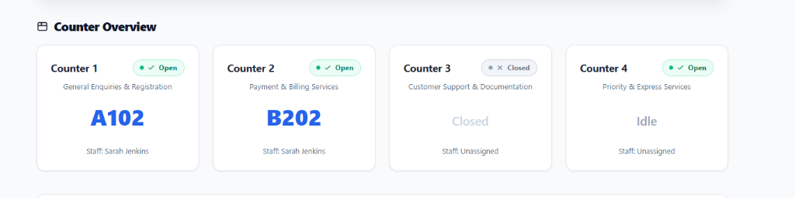

# Queue Management System (QueueFlow)

A modern, responsive, and enterprise-grade Smart Queue & Citizen Appointment Management System built with **HTML5, CSS3, Native PHP, and MySQL**. Designed according to realistic government service center workflows (e.g. Immigration & Registration Centers) featuring **Citizen Online Booking & Document Submission, Fast-Track Office Check-In, Strict Service Counter Routing, Live Large-Screen Calling Display with Audio Announcements, QR-Code Mobile Tracking**, and an **Examiner Presentation Demo & Simulation Toolkit**. Ready for local deployment using **XAMPP** or cloud deployment via **cPanel**.

[](LICENSE)
[](https://www.php.net/)
[](https://www.mysql.com/)

---

## 1. System Screenshots & Preview

| Portal Login | Live Calling Display |
| :---: | :---: |
|  |  |

| Staff Service Workstation | Administrator Queue Monitor |
| :---: | :---: |
|  |  |

| Mobile Live Tracker | Ticket Status Search |
| :---: | :---: |
|  |  |

---

## 2. Key System Capabilities & Architecture

### A. Public Citizen Portal (`/user/*`)
- **Citizen Account Registration & Authentication**: Quick registration with Full Name, IC/Passport number, phone, email, and secure Bcrypt password.
- **Online Service Appointments (`user/book_appointment.php`)**: 4-step wizard to select departmental services (Passport Renewal, Passport Application, Visa, Work Permit, Inquiries), select date, choose from real-time slot capacities (e.g., `08:30 - 09:30`, with dynamic `slots left` badge), and provide application notes.
- **Office Arrival Check-In (`user/checkin.php`)**: Fast-tracks arrival at the service center. Eligible today's appointments are instantly verified, generating an official daily queue ticket (e.g., `A001`), linking customer IC/phone, and routing to the designated physical counter.
- **Online Document Applications (`user/my_applications.php`, `user/new_application.php`)**: Pre-submission of passport/visa documentation with reference tracking (`IMP-YYYYMMDD-XXXX`) and review statuses (`Submitted`, `Under Review`, `Approved`, `Rejected`).
- **Printable Receipts & QR Live Tracking**: Instant printable ticket slip and live mobile tracker syncing with queue progress.

### B. Staff Service Workstation (`/staff/*`)
- **Station Binding & Department Service Routing**: Counter staff bind to specific counters (Counter 01 for Passport Renewal, Counter 02 for Visa, etc.).
- **Sequential Smart Calling**: `Call Next` strictly pulls matching service tickets without cross-calling.
- **Full Operational Lifecycle**: `Start Serving`, `Recall Number` (triggers audio announcement on public display), `Mark Completed`, and `Skip Number` (no-show handling).
- **Citizen Identification**: Displays customer name, IC/passport, phone number, and appointment reference directly on the counter dashboard.

### C. Public Kiosk & Large Calling Screen
- **Touch Walk-In Kiosk (`index.php`)**: Full touch-friendly card grid for walk-in visitors to select services and instantly obtain paper slips.
- **Live Calling Display (`display.php`)**: Designed for large wall monitors/TVs. Features real-time digital clock, date, audio speech synthesis announcement ("Ticket A 0 0 1, please proceed to Counter 01"), sound mute switch, and F11 fullscreen toggle.
- **Mobile Queue Tracker (`mobile_tracker.php`)**: Zero-install mobile web page allowing citizens to wait comfortably outside with live status badges (`Waiting`, `Calling`, `In Service`, `Completed`).

### D. Administrator Control Suite & Presentation Toolkit (`/admin/*`)
- **Presentation Demo & Simulation Toolkit (`admin/system_reset.php`)**:
  - `Seed Standard Demo Queue`: Generates standard presentation scenarios (A001 Serving at Counter 01, A002 Called at Counter 02, A003 & A004 Waiting) for live project demonstrations.
  - `Simulate Walk-in Visitor`: Simulates an instant customer arrival dispensing a new ticket.
  - `Reset Today's Queue`: Clears today's tickets and resets appointments back to pending.
- **Service Catalog Management (`admin/services.php`)**: Configure service codes, names, descriptions, estimated duration (e.g., 15m, 30m), and active/inactive statuses.
- **Appointment Audit & Filter (`admin/appointments.php`)**: Filter by date, status, and manage attendance.
- **Document Application Approvals (`admin/applications.php`)**: Review and approve/reject online applications with officer remarks.
- **Citizen Account Management (`admin/user_management.php`)**: Manage registered citizens and view booking history.
- **Queue Monitor & Counter Control (`admin/queues.php`, `admin/counters.php`)**: Override queue statuses and assign officers to stations.

---

## 3. Technology Stack

- **Frontend**: HTML5, Modern CSS3 (Flexbox, CSS Grid, Custom SVG Icons, Responsive Design, Print Media Styles)
- **Backend**: Native PHP 8.x (Prepared Statements with PDO, Session Authentication, Strict Role Guards)
- **Database**: MySQL 5.7+ / MariaDB 10.x (InnoDB, Foreign Key Constraints, Indexes)
- **Deployment Environments**: Local XAMPP (Apache + MariaDB) & Live cPanel Hosting

---

## 4. Default Demo Accounts

| Role | Username | Password | Access Area | Quick Demo Button |
| :--- | :--- | :--- | :--- | :--- |
| **Administrator** | `admin` | `admin123` | Full Access (`/admin/*`) | **1-Click Button on Login** |
| **Staff Member 1** | `staff1` | `staff123` | Staff Station (`/staff/index.php`) | **1-Click Button on Login** |
| **Staff Member 2** | `staff2` | `staff123` | Staff Station (`/staff/index.php`) | Manual entry |
| **Public Citizen** | `user` | `user123` | Citizen Portal (`/user/*`) | **1-Click Button on Login** |

---

## 5. Installation & Setup Guide

### Local Deployment (XAMPP)

1. **Place project inside XAMPP**:
   ```bash
   C:\xampp\htdocs\Queue_management_system
   ```

2. **Database Setup**:
   - Start **Apache** and **MySQL** in XAMPP Control Panel.
   - Open phpMyAdmin (`http://localhost/phpmyadmin`).
   - Create database `queue_db` and import `database/schema.sql`.

3. **Database Configuration**:
   - Verify `config/database.php` (configured by default for standard XAMPP localhost port 3307 / 3306).

4. **Launch Application**:
   - Self-Service Kiosk: `http://localhost/Queue_management_system/`
   - Public Calling Display: `http://localhost/Queue_management_system/display.php`
   - Portal Login: `http://localhost/Queue_management_system/login.php`
   - Citizen Registration: `http://localhost/Queue_management_system/register.php`

### Live Hosting Deployment (cPanel)

1. Upload all files to your cPanel `public_html` or subdomain directory.
2. Create database and user with ALL PRIVILEGES in **cPanel -> MySQL Databases**.
3. Import `database/cpanel_database.sql` via phpMyAdmin (clean SQL script without conflicting CREATE/USE statements).
4. Update `config/database.php` with your cPanel database name, user, and password.

---

## 6. Running Automated Verification

To verify syntax, security escaping, database schemas, role separation, and queue lifecycle:
```bash
php tests/verify.php
```

---

## 7. License

This project is licensed under the [MIT License](LICENSE).
